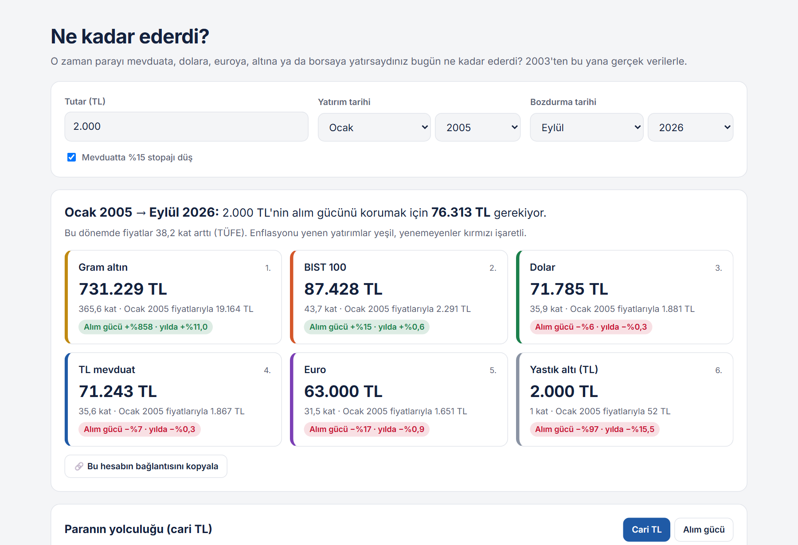

# Ne Kadar Ederdi?

**O zaman parayı mevduata, dolara, euroya, altına ya da borsaya yatırsaydınız bugün ne kadar ederdi?**

Tutarı ve iki tarihi seçin; sayfa altı yatırım seçeneğinin sonucunu hem cari TL hem de **alım gücü** (enflasyondan arındırılmış) olarak gösterir. 2003'ten bugüne gerçek aylık verilerle çalışır.

### 🔗 [Hesaplayıcıyı aç](https://mehmet-vural.github.io/ne-kadar-ederdi/)

[](https://mehmet-vural.github.io/ne-kadar-ederdi/)

## Ne hesaplıyor?

| Seçenek | Nasıl hesaplanıyor? | Kaynak |
|---|---|---|
| **TL mevduat** | Para her ay, bankaların 3 aya kadar vadeli TL mevduata fiilen uyguladığı ağırlıklı ortalama faizin 1/12'si kadar büyür (aylık bileşik). İsteğe bağlı %15 stopaj. | TCMB EVDS (TP.TRY.MT02) |
| **Dolar / Euro** | Başlangıç ayının ortalama kurundan alınır, bitiş ayının ortalama kurundan bozdurulur. | Avrupa Merkez Bankası referans kurları |
| **Gram altın** | Ons fiyatı ($) × dolar kuru ÷ 31,1035 | Dünya Bankası Pink Sheet |
| **BIST 100** | Ay sonu kapanış değeri (fiyat endeksi, temettü hariç) | Borsa İstanbul / Yahoo Finance |
| **Yastık altı** | Para TL olarak bekler. | |
| **Alım gücü** | Sonuç, iki tarih arasındaki TÜFE artışına bölünür. | IMF, TÜFE genel endeksi |

Örnek: **Ocak 2005'te 2.000 TL**, Eylül 2026'da:

| | Cari TL | Alım gücü değişimi |
|---|---|---|
| Gram altın | 731.229 TL | +%858 |
| BIST 100 | 87.428 TL | +%15 |
| Dolar | 71.785 TL | −%6 |
| TL mevduat (%15 stopaj) | 71.243 TL | −%7 |
| Euro | 63.000 TL | −%17 |
| Yastık altı | 2.000 TL | −%97 |
| *Alım gücünü korumak için gereken* | *76.313 TL* | |

Hesabın bağlantısı paylaşılabilir: [`?tutar=2000&bas=2005-01`](https://mehmet-vural.github.io/ne-kadar-ederdi/?tutar=2000&bas=2005-01)

## Veri hakkında bir not: Hangi mevduat faizi?

Uluslararası veri tabanlarındaki (IMF, Dünya Bankası) Türkiye "deposit rate" serisi, bankaların **uygulayabileceği azami (tavan) faiz**. Ortalamayı yıllara göre 5–15 puan yüksek gösteriyor (ör. Ocak 2023: tavan %35, ortalama %15,5). Bu seriyle hesaplandığında 2005'ten bu yana mevduat, alım gücünü %168 artırmış görünüyor; gerçek ortalama faizle sonuç **−%7**. Bu yüzden hesaplayıcı TCMB'nin **fiilen uygulanan ağırlıklı ortalama** faizini kullanıyor.

## Sınırlılıklar

- Mevduat hesabı aylık bileşik bir yaklaşım; gerçekte vade, banka ve tutara göre faiz farklıdır. Stopaj oranı yıllar içinde %0 ile %18 arasında değişti; hesaplayıcı tek bir oran (%15) kullanır.
- Kur makası, kuyumcu makası, işçilik, komisyon ve diğer vergiler dahil değil.
- BIST 100 fiyat endeksi temettüleri içermez; hisse getirisini olduğundan düşük gösterir.
- Aylık ortalama veriler kullanıldı; ay içindeki dalgalanmalar yansımaz.
- Geçmiş getiriler geleceğin göstergesi değildir. Bu proje yatırım tavsiyesi değildir.

## Çalıştırma

```bash
pip install pandas openpyxl
python veri_hazirla.py --indir   # verileri kaynaklardan indirir, veri.json'u üretir
python -m http.server            # http://localhost:8000
```

Sayfa tek bir `index.html` dosyası; derleme gerektirmez. Grafik için Chart.js kullanılır.

## Dosyalar

```
index.html        Hesaplayıcı (HTML + JavaScript)
veri.json         Sayfanın kullandığı aylık seri (2003–bugün)
veri_hazirla.py   Veri indirme ve hazırlama
veri/aylik_seri.csv  Aynı serinin tablo hali
```

---

Mehmet Vural · [LinkedIn](https://www.linkedin.com/in/mehmetvrl/) · [GitHub](https://github.com/mehmet-vural)
